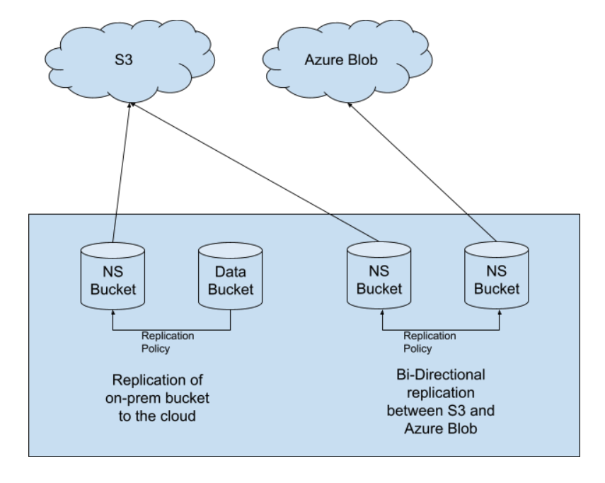

# Bucket Replication


## GOALS
 * Data replication of objects which are stored in any NooBaa bucket (data bucket, namespace bucket) -
    * Provides a higher resiliency
    * Data buckets / namespace buckets can be backed by any supported cloud provider (S3, Azure etc)
    * The replication is one way replication - from a source NooBaa bucket to a destination NooBaa bucket.
    * Replication can be bidirectional by setting a complementing replication configuration on the destination bucket.
 * Provide the user the ability to set a replication configuration on a bucket. 

## OUT OF SCOPE
 * Versions are not replicated - only the latest version
 * Deletions are not replicated
 * Optimizations


## SOLUTION

<div id="top" />


### Replication configuration schema
  * a replication policy composed of a list of replication rules,
    each rule defines rule id and a destination bucket 
    and optionally defines a filter based on the object key prefix

Structure of replication rules which was added to a new replication configuration collection schema:

```
    replication_rules: {
        type: 'array',
        items: {
            type: 'object',
            required: ['destination_bucket', 'rule_id'],
            properties: {
                rule_id: { type: 'string' },
                destination_bucket: {
                    objectid: true // bucket id
                },
                filter: {
                    type: 'object',
                    properties: {
                        prefix: { type: 'string' },
                    }
                }
            }
        }
    },
```

In addition, the bucket schema updated with a new replication_policy_id field.

### Setting changes to the replication configuration -  APIs
The end user will add changes to the bucket replication configuration by calling APIs

The following diagram APIs will be introduced:  
        </br>* put bucket replication  
         </br>* get bucket replication  
         </br>* delete bucket replication  

 * put_bucket_replication - 
 This method will set the replication configuration to the bucket's entity.


 Schema of the method:
 ```
    put_bucket_replication: {
        method: 'PUT',
        params: {
            type: 'object',
            required: [
                'name', 'replication_policy'
            ],
            properties: {
                name: { $ref: 'common_api#/definitions/bucket_name' },
                replication_policy: { $ref: '#/definitions/replication_policy' },
            },
        },
        auth: {
            system: ['admin', 'user']
        }
    }
 ```

  * get_bucket_replication - 
 This method will get the replication configuration of the bucket's entity.


 Schema of the method:
 ```
    get_bucket_replication: {
        method: 'GET',
        params: {
            type: 'object',
            required: [
                'name'
            ],
            properties: {
                name: { $ref: 'common_api#/definitions/bucket_name' },
            },
        },
        reply: {
            $ref: '#/definitions/replication_policy'
        },
        auth: {
            system: ['admin', 'user']
        }
    }
 ```


 * delete_bucket_replication - 
 This method will remove the replication configuration from the bucket's entity.


 Schema of the method:
 ```
    delete_bucket_replication: {
        method: 'DELETE',
        params: {
            type: 'object',
            required: [
                'name'
            ],
            properties: {
                name: { $ref: 'common_api#/definitions/bucket_name' },
            },
        },
        auth: {
            system: ['admin', 'user']
        }
    }
 ```

### TODO: 
 * BG Worker
 * Operator side

### TESTS
 *  A new unit tests file was created for the bucket replication feature - test_bucket_replication.js

---

## Log-Based Replication

Log-based replication is an optimised alternative to the diff-based (scan) replication scanner. Instead of listing and comparing all objects across the source and destination buckets on every cycle, it reads the source bucket's operation logs and replicates only the objects that actually changed.

Three log sources are supported, selected by the `endpoint_type` in the replication policy:

| `endpoint_type` | Log source | Bucket types supported |
|---|---|---|
| `AWS` | AWS S3 Server Access Logs | Namespace buckets backed by S3 |
| `AZURE` | Azure Monitor / Log Analytics | Namespace buckets backed by Azure Blob (`endpoint_type: AZURE`). See Azure section. |
| `NOOBAA` | NooBaa's own persistent bucket logging | MCG data buckets; namespace buckets (logging enabled on the underlying data bucket) |

### NooBaa Log-Based Replication

#### Overview

NooBaa's endpoint records every S3 operation as a JSON line appended to a per-node log file on disk (PERSISTENT mode). A background worker (`BucketLogUploader`) periodically rotates and uploads those files as S3 objects into a designated *log bucket*. The log replication scanner then reads those objects and drives replication.

#### Prerequisite: `GUARANTEED_LOGS_PATH` (persistent bucket logs)

NooBaa log-based replication depends on **persistent** bucket logging: durable JSON lines on local disk that `BucketLogUploader` later uploads into the log bucket for `LogReplicationScanner` to read.

That mode is **not** enabled by default. At process startup, `config.BUCKET_LOG_TYPE` is set from the environment:

| `GUARANTEED_LOGS_PATH` | `BUCKET_LOG_TYPE` | Behaviour |
|---|---|---|
| **Unset** | `BEST_EFFORT` | Bucket operation records are sent to **syslog** service. `BucketLogUploader` does **not** use the persistent export path (`export_logs_to_target`). Log objects in the designated log bucket are not produced reliably, so log-based replication has no dependable input. |
| **Set** to a writable directory | `PERSISTENT` | Each endpoint opens a `PersistentLogger` under that directory (`PERSISTENT_BUCKET_LOG_DIR`) and appends JSON lines to a **per-node** file (`bucket_logging_<node_name>`). `BucketLogUploader` uploads those files into the buckets configured via `PutBucketLogging`. |

**Required setup: shared storage**

`BucketLogUploader` does not pull logs from other nodes. Using the **same path string** on separate local volumes does **not** let the uploader see other endpoints' files; those logs are never uploaded and log-based replication misses those writes.

1. Back `GUARANTEED_LOGS_PATH` with **shared storage** (for example RWX PVC / NFS) that **every S3 endpoint and the process running `BucketLogUploader`** can mount and write/read.
2. Set **`GUARANTEED_LOGS_PATH`** to that shared directory on endpoints and on the core. The path must be writable and durable across restarts.
3. Keep **`BucketLogUploader`** enabled (`config.BUCKET_LOG_UPLOAD_ENABLED`, default on) so files on the shared path are uploaded to the log bucket on a schedule (`BUCKET_LOG_UPLOADER_DELAY`).

Without `GUARANTEED_LOGS_PATH` on shared storage visible to both writers and the uploader, persistent logs are incomplete and NooBaa log-based replication cannot be relied on. AWS and Azure log-based replication do not use this variable; they read logs from the cloud provider.

#### Enabling NooBaa Log-Based Replication

After `GUARANTEED_LOGS_PATH` is set (see above), two things must be configured:

1. **Bucket logging** — enabled on the bucket that actually receives writes (should be a data bucket). The log target is the log bucket + prefix where log objects will be stored:

   ```json
   {
     "log_bucket": "my-log-bucket",
     "log_prefix": "src-bucket-logs/"
   }
   ```

   Bucket Logging can be enabled using the `PutBucketLogging` API.

2. **Replication policy** — set on the *source* bucket (it may be a data bucket **or** a namespace bucket. It is set up on top of the data bucket from step 1 on which logging was enabled). The `log_replication_info` must use `endpoint_type: "NOOBAA"` and point to the same log bucket + prefix:

   ```json
   {
     "log_replication_info": {
       "endpoint_type": "NOOBAA",
       "logs_location": {
         "logs_bucket": "my-log-bucket",
         "prefix": "src-bucket-logs/"
       }
     }
   }
   ```

   The `endpoint_type: "NOOBAA"` here is derived from the enum `log_replication_endpoint_type`.

#### Supported Bucket Configurations

**Case 1 — MCG data bucket as replication source**

Replication is configured on the data bucket. Logging is enabled on the same bucket. Both the replication policy and the bucket logging configuration point at the same log bucket/prefix.

```
Client → PutObject → [data-bucket] → log entry (source_bucket="data-bucket")
                                         ↓
                                    [log-bucket/prefix/...]
                                         ↓
                          LogReplicationScanner reads logs → CopyObject to destination NS/data bucket
```

**Case 2 — Namespace bucket as replication source (logging on the underlying data bucket)**

Replication is configured on the namespace bucket. The NS layer proxies writes to the underlying data bucket, which has logging enabled. The log entries record the data bucket name, not the namespace bucket name.

```
Client → PutObject → [ns-bucket] → NS layer → [data-bucket] → log entry (source_bucket="data-bucket")
                                                                     ↓
                                                            [log-bucket/prefix/...]
                                                                     ↓
                                                    - LogReplicationScanner reads logs
                                                    - HeadObject on ns-bucket (NS layer proxies to data bucket)
                                                    - CopyObject to destination NS/data bucket
                                                    
```
(**Note: In the above flow diagram, the NS layer proxies to the data bucket since the actual operations happen on the underlying data bucket**)

The scanner is routed to the NooBaa log path when `noobaa_log_replication_info` is present in the replication config — **regardless of whether the source bucket is a data bucket or namespace bucket**. This is the key difference from the AWS/Azure paths, which are routed by inspecting `source_bucket.namespace.write_resource.resource.connection.endpoint_type`.

The `endpoint_type` value from the API request is stripped during normalization in `bucket_server.normalize_replication()` and is not persisted.

---

### AWS Log-Based Replication

#### Overview

When the source namespace bucket is backed by an S3 endpoint, NooBaa reads the cloud provider's **S3 Server Access Logs** instead of NooBaa's own bucket logs. The log objects are uploaded by AWS S3 to a separate bucket and contain one log line per S3 operation in the [S3 Server Access Log format](https://docs.aws.amazon.com/AmazonS3/latest/userguide/LogFormat.html).

The scanner is routed to the AWS path when `aws_log_replication_info` is present in the replication config and the source bucket's namespace endpoint type is `AWS`.

#### Supported Bucket Configuration

```
Client → PutObject → [AWS S3] (remote)
                         ↓  S3 Server Access Log uploaded by cloud provider
                     [AWS log bucket/prefix/...]
                         ↓
         LogReplicationScanner (aws_get_next_log_entry + _aws_get_next_log)
         parses space-delimited log lines
                         ↓
         HeadObject on NooBaa NS bucket (NS layer proxies to S3)
         CopyObject to destination NS/data bucket
```

The source in NooBaa is a **namespace bucket** backed by an S3 resource. The replication scanner connects to the remote S3 endpoint using the access credentials from the namespace resource to fetch log objects.

We use S3 CopyObject to preserve the object's MetaData fields.

### Azure Log-Based Replication

#### Overview

When the source namespace bucket is backed by Azure Blob Storage, NooBaa queries **Azure Monitor Log Analytics** (via Kusto query language) to retrieve recent storage operations. Unlike AWS and NooBaa log types, Azure logs are not fetched as S3 objects — the scanner runs a KQL query against the Azure Log Analytics workspace and receives structured query results.

The log parser is routed to the Azure path when  `azure_log_replication_info` is present in the replication config and the source bucket's namespace endpoint type is `AZURE`.

Object copy still goes through the usual NooBaa S3 `CopyObject` → `NamespaceBlob` path and needs working **blob data-plane** credentials on the namespace connection (separate from Log Analytics credentials below).

#### Two credential sets

Azure log-based replication needs **both** of the following on the namespace resource connection. They serve different APIs and are not interchangeable.

##### 1. Blob data-plane credentials (`NamespaceBlob` Head / Copy)

Used when the scanner heads source objects and copies them to the destination via the NooBaa endpoint.

| Namespace `endpoint_type` | How blob auth works |
|---|---|
| **`AZURE`** | Storage account name + **account key** (connection string). Long-lived account key. |
| **`AZURESTS`** | **`azure_sts_credentials`**: `azure_tenant_id` + `azure_client_id` only (no client secret). Auth is **`WorkloadIdentityCredential`** using the projected OpenShift/K8s service-account token. Short-lived tokens are obtained at runtime; no long-lived Azure access token is stored in NooBaa. |

`azure_sts_credentials` does **not** include `azure_client_secret`. For blob I/O you need either an account key (AZURE) or STS workload identity (AZURESTS). The client secret is for log queries, not for `NamespaceBlob` and supplying only a client secret does **not** authenticate `NamespaceBlob`.

##### 2. Log Analytics credentials (`azure_log_access_keys`)

Required on the source namespace connection for the Kusto / Monitor query path. The log replication scanner does **not** read these from the replication policy; `_get_source_bucket_azure_connection` resolves them from the write namespace resource and builds a `LogsQueryClient` with **`ClientSecretCredential`**.

All of the following are required (see `common_api#/definitions/azure_log_access_keys`):

| Field | Purpose |
|---|---|
| `azure_tenant_id` | Microsoft Entra ID (Azure AD) tenant |
| `azure_client_id` | Application (client) ID for the service principal |
| `azure_client_secret` | Client secret for **Log Analytics** (`ClientSecretCredential`) |
| `azure_logs_analytics_workspace_id` | Workspace where **StorageBlobLogs** diagnostic logs are ingested |

Without `azure_log_access_keys`, log discovery fails even if blob I/O credentials are valid. Conversely, `azure_client_secret` alone cannot drive Head/Copy.

The replication policy's `azure_log_replication_info` (optional `prefix`, etc.) only shapes which blob operations are considered; it does **not** replace either credential set above.

#### Supported Bucket Configuration

```
Client → PutObject → [Azure Blob container] (remote)
                         ↓  Diagnostic logs sent to Log Analytics workspace
                     [Azure Monitor / Log Analytics]
                         ↓  KQL query (StorageBlobLogs) via azure_log_access_keys
         LogReplicationScanner (LogsQueryClient from @azure/monitor-query-logs)
         receives Write/Delete rows
                         ↓
         HeadObject on NooBaa NS bucket (NamespaceBlob: AZURE account key
             or AZURESTS workload identity)
         CopyObject to dst NS/data bucket
```

