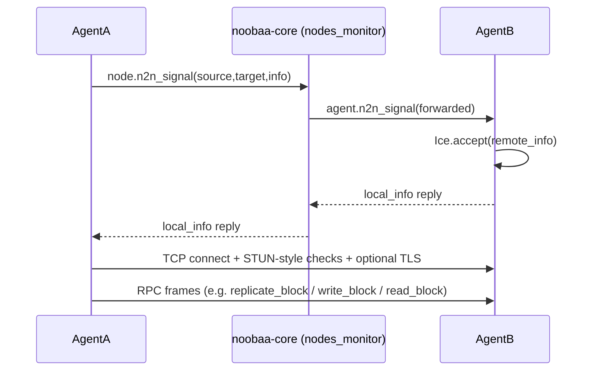
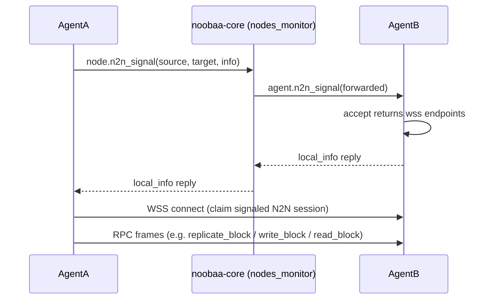

# Remove ICE

## Introduction

In NooBaa we have 2 deployments:
1. **NooBaa Non Containerized (NC)** - a lightweight deployment of NooBaa on Linux without depending on Kubernetes, it includes NooBaa service that deploys S3 endpoints for handling S3 requests.
2. **NooBaa Containerized (running on Kubernetes)** - this deployment includes full NooBaa architecture including noobaa-core, noobaa-endpoint, DB, noobaa-operator, etc.

The feature is only relevant for NooBaa Containerized.

In NooBaa we have 2 types of buckets:
1. **Namespace resource** - the data is stored as is to the resource (the S3 resource that was defined), NooBaa as cloud gateway.  
2. **Data Bucket** - objects are fragmented, deduped, compressed, encrypted, and written to the PV-pool or cloud pool.

The feature is only relevant for NooBaa Data Buckets.

## Background

NooBaa storage agents (“agents”) need to talk to each other over the network. Early NooBaa was designed for machines spread across the internet, behind home routers and firewalls.

**ICE** (Interactive Connectivity Establishment) is a standard for finding a working network path between two peers. NooBaa has its own minimal ICE implementation in [src/rpc/ice.js](https://github.com/noobaa/noobaa-core/blob/6.0/src/rpc/ice.js).

In Kubernetes, all pods get IPs on the same virtual network. Any pod can open a TCP connection to any other pod's IP directly — no **NAT** (Network Address Translation), no home router, so the problems we had to solve in the past are no longer relevant.

Agents need a direct peer RPC data channel for some block-store traffic on multi-node pools. Callers address agents with `n2n://<peer_id>` (when `AGENT_RPC_PROTOCOL=n2n`). That address is filled from the node at mapping time as `block_md.address`, not persisted on the [block row](https://github.com/noobaa/noobaa-core/blob/6.0/src/server/object_services/schemas/data_block_schema.js) — see [map_db_types](https://github.com/noobaa/noobaa-core/blob/3af1894935a7b9852ab690eeada74c0283b16eb0/src/server/object_services/map_db_types.js#L319).

## Current architecture

Agents have two independent channels:
1. Control channel ([heartbeat](https://github.com/noobaa/noobaa-core/blob/d8d96e7dac81111f412a6b075bc120be0445c4d0/src/server/node_services/nodes_monitor.js#L271), [config](https://github.com/noobaa/noobaa-core/blob/d8d96e7dac81111f412a6b075bc120be0445c4d0/src/server/node_services/nodes_monitor.js#L1103), [tokens](https://github.com/noobaa/noobaa-core/blob/d8d96e7dac81111f412a6b075bc120be0445c4d0/src/server/node_services/nodes_monitor.js#L1070), [diagnostics](https://github.com/noobaa/noobaa-core/blob/6.0/src/server/node_services/nodes_monitor.js#L3016)) - Direct RPC to nodes monitor inside noobaa core.
2. Data channel - Block [read](https://github.com/noobaa/noobaa-core/blob/d8d96e7dac81111f412a6b075bc120be0445c4d0/src/agent/block_store_services/block_store_base.js#L142)/[write](https://github.com/noobaa/noobaa-core/blob/d8d96e7dac81111f412a6b075bc120be0445c4d0/src/agent/block_store_services/block_store_base.js#L228)/[replicate](https://github.com/noobaa/noobaa-core/blob/d8d96e7dac81111f412a6b075bc120be0445c4d0/src/agent/block_store_services/block_store_base.js#L291) between peers. Address `n2n://<peer_id>` → signal via core → direct peer link.

ICE only sits under the data channel.

Note: Agents do not mutually authenticate each other over the peer link; trust for who may connect comes from the signal path. Signaling is only available to already-authed agents (is done by `nodes_monitor` in noobaa-core). 

## N2N Communication Flows

Flows that use the peer data channel include:
- **Block write / read** — endpoint dials the storage agent (`write_block` / `read_block`).
- **Block replication** — endpoint writes the first copy (`write_block`), then dials other agents with `replicate_block`; each target reads from the source agent (`read_block`) and writes locally.
- **Connectivity** — core `nodes_monitor` dials agents for `test_network_perf` / `test_network_perf_to_peer` (including peer-to-peer tests).

## Design Decisions

- Keep logical peer addresses as `n2n://<peer_id>` and keep the class of `RpcN2NAgent`.
- Keep core-relayed `n2n_signal` as the control path (`nodes_monitor`).
- Move agent-to-agent RPC onto WSS.
- Ensure the direct peer link opened after signaling is tied to that N2N session (not treated as a normal agent RPC connection).
- Remove ICE/STUN and the custom TCP N2N handshake from the default path.
- Upgrade will be made to noobaa-core and all agents together (no mixed ICE and WSS on the wire for a given peer pair).
- Persisted `n2n://` addresses and `n2n_config` remain valid; obsolete ICE-related fields can be ignored.
- Split the implementation to 2 phases:
  1. Add the new implementation with a flag to rollback to ICE (cluster-wise: all agents and core would need to have it).
  2. Remove the flag and cleanup the code from the repo.
- The solution should also take into account that a pod might have more than the default NICs (Network Interface Controller) `lo` (loopback) and `eth0` (cluster network).

## Target flow

