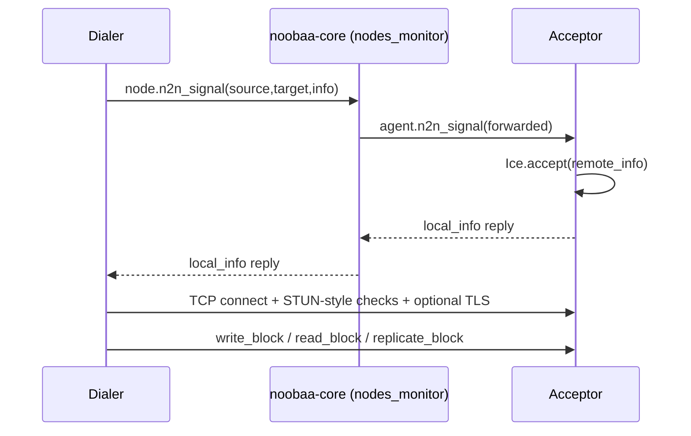
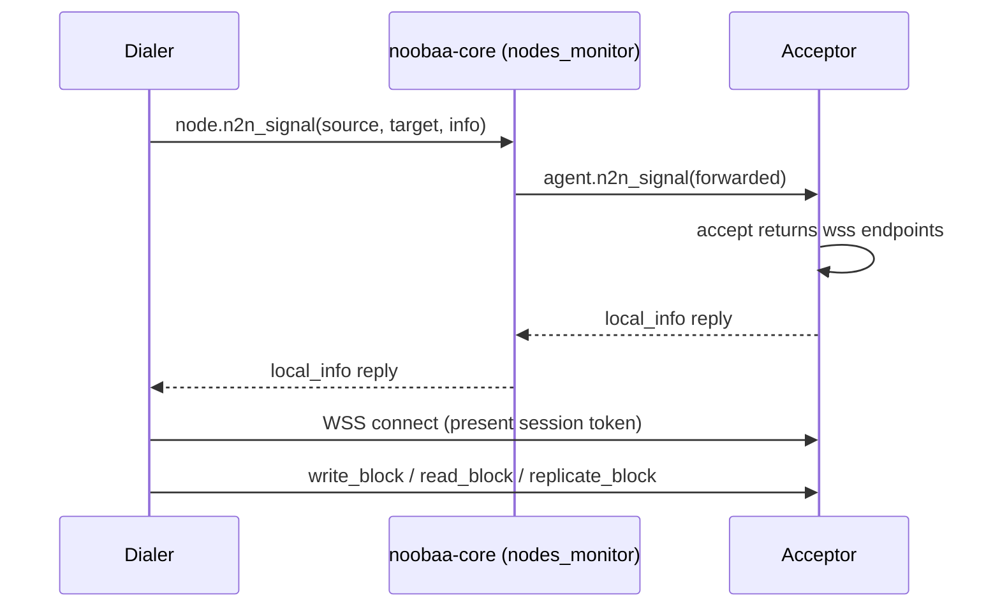

# Remove ICE

## Introduction

In NooBaa we have 2 deployments:
1. **NooBaa Non Containerized (NC)** - a lightweight deployment of NooBaa on Linux without depending on Kubernetes, it includes NooBaa service that deploys S3 endpoints for handling S3 requests.
2. **NooBaa Containerized (running on Kubernetes)** - this deployment includes full NooBaa architecture including noobaa-core, noobaa-endpoint, DB, noobaa-operator, etc.

The feature is only relevant for NooBaa Containerized.

In NooBaa we have 2 types of buckets:
1. **Namespace resource** - the data is stored as is to the resource (the S3 resource that was defined), NooBaa as cloud gateway.
2. **Data Bucket** - objects are fragmented, deduped, compressed, encrypted, and written to the PV-pool or cloud pool.

The feature is only relevant for NooBaa Data Buckets.

## Background

NooBaa storage agents (“agents”) need to talk to each other over the network. Early NooBaa was designed for machines spread across the internet, behind home routers and firewalls.

**ICE** (Interactive Connectivity Establishment) is a standard for finding a working network path between two peers. NooBaa has its own minimal ICE implementation in [src/rpc/ice.js](https://github.com/noobaa/noobaa-core/blob/6.0/src/rpc/ice.js).

In Kubernetes, all pods get IPs on the same virtual network. Any pod can open a TCP connection to any other pod's IP directly — no **NAT** (Network Address Translation), no home router, so the problems we had to solve in the past are no longer relevant.

Agents need a direct peer RPC data channel for some block-store traffic on multi-node pools. Callers address agents with `n2n://<peer_id>` (when `AGENT_RPC_PROTOCOL=n2n`). That address is filled from the node at mapping time as `block_md.address`, not persisted on the [block row](https://github.com/noobaa/noobaa-core/blob/6.0/src/server/object_services/schemas/data_block_schema.js) — see [map_db_types](https://github.com/noobaa/noobaa-core/blob/3af1894935a7b9852ab690eeada74c0283b16eb0/src/server/object_services/map_db_types.js#L319).

## Current Architecture

Agents have two independent channels:
1. Control channel ([heartbeat](https://github.com/noobaa/noobaa-core/blob/d8d96e7dac81111f412a6b075bc120be0445c4d0/src/server/node_services/nodes_monitor.js#L271), [config](https://github.com/noobaa/noobaa-core/blob/d8d96e7dac81111f412a6b075bc120be0445c4d0/src/server/node_services/nodes_monitor.js#L1103), [tokens](https://github.com/noobaa/noobaa-core/blob/d8d96e7dac81111f412a6b075bc120be0445c4d0/src/server/node_services/nodes_monitor.js#L1070), [diagnostics](https://github.com/noobaa/noobaa-core/blob/6.0/src/server/node_services/nodes_monitor.js#L3016)) - Direct RPC to nodes monitor inside noobaa core.
2. Data channel - Block [read](https://github.com/noobaa/noobaa-core/blob/d8d96e7dac81111f412a6b075bc120be0445c4d0/src/agent/block_store_services/block_store_base.js#L142)/[write](https://github.com/noobaa/noobaa-core/blob/d8d96e7dac81111f412a6b075bc120be0445c4d0/src/agent/block_store_services/block_store_base.js#L228)/[replicate](https://github.com/noobaa/noobaa-core/blob/d8d96e7dac81111f412a6b075bc120be0445c4d0/src/agent/block_store_services/block_store_base.js#L291) between peers. Address `n2n://<peer_id>` → signal via core → direct peer link.

ICE only sits under the data channel.

The dialer is often the endpoint (object IO); it can also be another storage agent (for example during block replication) or core (`nodes_monitor` connectivity tests).  
The acceptor is the peer that listens and accepts the direct link (typically a storage agent).

## N2N Communication Flows

Flows that use the peer data channel include:
- **Block write / read** — endpoint dials the storage agent (`write_block` / `read_block`).
- **Block replication** — endpoint writes the first copy (`write_block`), then dials other agents with `replicate_block`; each target reads from the source agent (`read_block`) and writes locally.
- **Connectivity** — core `nodes_monitor` dials agents for `test_network_perf` / `test_network_perf_to_peer` (including peer-to-peer tests).

## Design Decisions

- Keep logical peer addresses as `n2n://<peer_id>` and keep the class of `RpcN2NAgent`.
- Keep core-relayed `n2n_signal` as the control path (`nodes_monitor`).
- Move peer N2N RPC (endpoint↔agent, agent↔agent, and core↔agent connectivity tests) onto WSS.
- Ensure the direct peer link opened after signaling is tied to that N2N session (not treated as a normal agent RPC connection). More details are in [Auth in The Flow](#auth-in-the-flow).
- Remove ICE/STUN and the custom TCP N2N handshake from the default path.
- Upgrade will be made cluster-wide: noobaa-core, noobaa-endpoint, and all storage agents together (no mixed ICE and WSS on the wire for a given dialer–acceptor pair).
- Persisted `n2n://` addresses and `n2n_config` remain valid; obsolete ICE-related fields can be ignored.
- Split the implementation to 2 phases:
  1. Add the new implementation with a flag to rollback to ICE (cluster-wise: core, endpoints, and agents must agree on the same mode).
  2. Remove the flag and cleanup the code from the repo.
- The solution should also take into account that a pod might have more than the default NICs (Network Interface Controller) `lo` (loopback) and `eth0` (cluster network). More details are in [Address Exchange](#address-exchange).

## Target Flow

## Auth in The Flow

Trust for who may open a peer connection comes from core signaling and a short-lived session token:

1. Only agents already authenticated to core may use `n2n_signal`.
2. The acceptor creates a one-time session token, waits for a matching inbound connect, and returns the token plus its listen endpoints in the signal reply.
3. Core forwards that reply to the dialer.
4. The dialer opens WSS to the acceptor and includes that token. The acceptor accepts the connection only if the token matches the pending session; otherwise it rejects the connection. After a successful accept, the token is removed so it cannot be reused.
5. Pending tokens expire after the RPC connect timeout (default 120 seconds like `RPC_CONNECT_TIMEOUT`). This binds the inbound WSS connection to the signaled N2N session. It is not a long-lived shared secret between agents. That timeout is a single deadline for the whole open, including the dialer trying multiple advertised endpoints. Quick failures leave time for later endpoints; a hung first attempt can use up the window.

## Address Exchange

Unchanged: `n2n_signal` via core; `n2n://<peer_id>`; collecting IPs from interfaces
(and public IPs) and preferring private ones when dialing.

Changed:
- **Before (ICE):** The acceptor advertised ICE candidates over a TCP **port range**
  (and optional UDP/STUN). The dialer ran connectivity checks against those candidates.
- **After (WSS):** The acceptor listens on a **single** WSS port and advertises
  `wss://<ip>:<port>` (plus the session token). The dialer still tries the acceptor’s
  advertised targets in priority order, but opens a WSS connection to each
  instead of running ICE candidate connectivity checks.

With `hostNetwork: true`, multiple agents on the same node share the host port
space, so the default port can be busy (`EADDRINUSE`). If the acceptor’s default WSS port is taken, the acceptor binds the next free port in the allowed range and publishes that bound port in the signal reply so the dialer dials the correct port.

## Connection Management

A peer link is managed in three phases:

1. **Open** — after `n2n_signal`, the dialer connects to the acceptor and the link becomes ready for RPC.
2. **Use** — RPC calls (`write_block` / `read_block` / `replicate_block`) are sent over that link.
3. **Close** — on error or N2N config change/reset, the link is closed and a later call opens a new one.

Open → Use → Close is unchanged. What changed is how **Open** / **Close** work on the wire:

- **Before (ICE):**
  - Open meant ICE connectivity checks on advertised candidates, then an ICE session on the chosen TCP link (UDP optional, rarely used).
  - Close tore down that ICE session.
- **After (WSS):**
  - Open: the acceptor waits briefly for an inbound connect with the session token; the dialer opens a WebSocket and presents that token.
  - Close: if the acceptor is still waiting for the session token, remove that pending token (so late WSS attempts with it are rejected); close the WebSocket if it was opened.

## Testing Plan

### Setup:
1. NooBaa was installed and log level: `"NOOBAA_LOG_LEVEL":"all"`
2. Backingstore with multi-agents: `--num-volumes 2`
3. Bucket class (`placement-bucketclass`) using the backingstores
4. Default replicas to 2: `"CONFIG_JS_CHUNK_CODER_REPLICAS":"2"`
5. Create OBC
6. For Hosted agents we will create 2 additional backingstores with type AWS, bucket class and OBC.

### Cases:
1. Place PV-pool agents on different worker nodes (cross-node peer dial), e.g. by labeling agent pods and setting NooBaa CR affinity.
- Expected result: Each agent pod runs on a different worker node.
2. Upload an object (with replicas) using the OBC credentials and then get the object.
- Expected result: We could get the object, looking at the agents pod logs we could see the replicate and write of blocks, and also can see that the number of the blocks in each pod (.data) increased.
3. Delete one replica copy of an object (specific block inside the pod) and get object
- Expected result: We could get the same object that we already uploaded.
4. Change the IP Address of an agent (by deleting a pod it happens automatically).
- Expected result: Backingstore is in Ready phase, and PUT/GET object still work.
5. Test peer communication between two cloud-pool (hosted) agents: create two AWS-type backingstores, a bucket class over them, and an OBC; upload an object.
- Expected result: Upload succeeds and blocks appear in both target cloud buckets (`.data`).
6. Scale the number of pods and replicas: from 2 to 3 and upload an object.  
Note: Must remove the CR affinity before, so the pod would not stay in Pending state.
- Expected result: We can upload an object and can see blocks (.data) in the new created pod.
7. Performance Test using warp for PUT and GET.
- Expected Result: We should make sure there is no degradation between using WSS and using ICE.
8. (special cluster) Tests on a cluster with IPV6 from the list above: upload an object.
- Expected result: Upload should succeed, can see the replicate block.  
9. (special cluster) Test the communication between 2 storage agents in a cluster where there is configuration of `hostNetwork` true.
- Expected result: Upload should succeed, can see the replicate block.