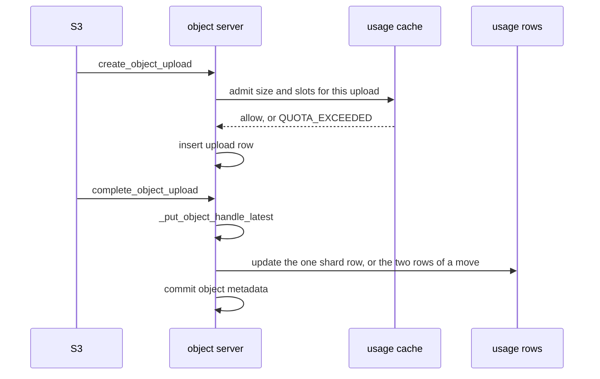

# Strict bucket quota

Status: design for strict bucket quota.
No code accompanies this document.

The default async quota — configuration, alerts, and aggregator enforcement —
stays as specified in [quota.md](quota.md). This document is only the strict path.

Audience: NooBaa maintainers who will implement this, and reviewers checking the
accounting and concurrency. The document is self-contained. Engineering judgment
is marked.

## 1. Introduction

### 1.1 What async quota does

A bucket may carry a size limit, an object-count limit, or both. The background
`md_aggregator` folds object metadata into `bucket.storage_stats` on its existing
cycle (30 seconds). `check_quota` reads those stats, raises the existing 80% and
100% alerts, and rejects a new upload with `OBJECT_QUOTA_EXCEEDED` once either
stat has reached its limit. The S3 endpoint maps that code to
`409 ObjectQuotaExceeded`.

The stats are eventually consistent. A writer can pass the check for as long as
the last aggregation cycle still shows the bucket under the limit, and a delete
does not free capacity until a later cycle. That lag is the reason for a second
mode.

### 1.2 What strict mode adds

A quota marked strict keeps a live byte count and a live object count, and
updates them on the same request that commits or removes the object. A write
that would pass either limit is rejected with `QUOTA_EXCEEDED`, mapped to
`403 QuotaExceeded`.

Strict mode is opt-in. A quota with no mode is async, and every existing caller
keeps the aggregator path. On a strict bucket the write path does not also call
`check_quota`. The aggregator numbers lag a delete, and a second verdict from
those numbers would keep denying capacity the live counter has already released.
Alerts and the quota percentages continue to read `storage_stats`.

### 1.3 Glossary

| Term | Meaning |
|---|---|
| **async quota** | The default. Limits are compared to `storage_stats` from `md_aggregator`. |
| **strict quota** | Limits are compared to the live counter. |
| **usage row** | One document in the new usage collection: bucket id, shard, bytes used, objects used. |
| **shard** | An integer in `[0, N-1]`. A reservation is applied to the shard of the random number . The bucket total is the sum of its N rows. 
| **slot** | One object towards the quantity limit. A completed object and a delete marker each take one slot. An in-progress upload does not. |
| **reserve** | Add bytes and/or slots. Fails the request with `QUOTA_EXCEEDED` when the add would overflow. |
| **release** | Subtract bytes and/or slots, can have negative number. Never fails the caller. |
| **null version** | The object row with no version id. Versioning `DISABLED` has only this row. Versioning `SUSPENDED` overwrites it. Versioning `ENABLED` never overwrites it. |

## 2. Scope

**In scope**

1. A strict mode on the existing quota configuration, stored on the bucket.
2. A live counter, created when strict mode is turned on and removed when it is turned off or the bucket is deleted.
3. Simple `PutObject`: admit when the upload is created, reserve when it completes, release on delete.
4. Multipart: reserve each completed part's bytes, reserve the object slot when the upload completes, release bytes of parts the completed object does not keep, release those bytes on abort and on incomplete-upload expiration.
5. Versioning `ENABLED`, `SUSPENDED`, and `DISABLED`: new versions, null-version overwrite, delete markers, and version-id delete.
6. Release on single delete, multi-object delete, lifecycle expiration of noncurrent versions, lifecycle removal of expired delete markers, and lifecycle removal of incomplete multipart uploads.

**Out of scope**

- Namespace buckets, including NSFS. Strict mode is rejected when the quota is set. The counter lives in the metadata pool and is updated from the object server, which is not on the namespace write path.
- Turning strict mode on for a bucket that already has objects. There is no backfill from `storage_stats` or from a scan of object rows.
- Replacing async quota. Alerts and quota percentages keep reading `storage_stats`.
- Operator, OBC, and CLI surfaces. They already pass quota configuration through; strict mode is a field on that object. A UI control is separate.

## 3. Design decisions

### 3.1 The counter is its own collection

`bucket.storage_stats` is the wrong place for a per-request increment.

- `system_store` reloads and broadcasts on every config write. A counter update on that path would stall every endpoint on one bucket's quota.
- `md_aggregator` already owns `storage_stats`, on a 30 second cycle. Writing it from the data path would serialize uploads behind that cycle, which is the lag strict mode exists to remove.

The quota usage size and counter are managed within a distinct collection featuring its own dedicated schema. Each update is one parameterized statement against a document of about a hundred bytes. Object metadata, chunk maps, and `storage_stats` are left alone.

#### Quotas Schema

Quota is a new schema that hold the realtime quantity and size usage for buckets(should be able to hold other scope in future eg: accounts)

```
{
 	scope_id: bucket_id,                // bucket_id (or account_id, in future)
 	shard: 0,                           // 0 .. N-1(where N is configured integer value)
 	used_bytes: 0,
 	used_objects: 0,
	scope_type: { enum : [‘bucket’] }  // can have other values like customer, in future.
}
```

When strict quota is enabled for a bucket, Bucket's quota `mode` is updated with value `strict`.

Quota validation will happen against this schema. One bucket can have N number of entries in Quotas schema.
The schema uses a composite key comprising scope_id, scope_type, and shard.

Using a PostgreSQL UPSERT script, a PUT operation inserts or updates one rows within the quotausages schema.

```
INSERT INTO quotausages AS c (scope_type, scope_id, shard, used_bytes, used_objects)
VALUES ('bucket', '65f1c0ffee0000000000abcd', 3, 1048576, 1)
ON CONFLICT (scope_type, scope_id, shard) DO UPDATE
SET used_bytes   = c.used_bytes   + EXCLUDED.used_bytes,
    used_objects = c.used_objects + EXCLUDED.used_objects;
```

### 3.2 N shards, keyed by the random number

Each bucket can be configured with N rows (shards 0 to N-1), which are generated upon updating the schema with reserve values.

Reads sum every shard. Writes touch one shard.

The combination of bucket id and shard key owns the reservation:

Give each bucket N independent counters instead of one. On complete, pick one shard and update only that using. Method using for that is,
```
shard = random_number % N
```

When the N is 4, then Quota schema for bucket entries looks like this

| _id | scope_id | shard | used_bytes | used_objects | scope_type
| --- | --- | --- | --- | --- | ---|
| 12345a | 12345 |0 | 1Gi |  1| bucket |
| 12345a | 12345 | 1 | 2Gi | 3 | bucket |
| 12345a | 12345 | 2 | 6Gi | 1 | bucket |
| 12345a | 12345 | 3 | 10Gi | 5 | bucket |
|  |  | SUM | 19Gi | 10 |

When validate the Quota, SUM of each row is calculated and that total value is compared against the current upload value


 N shards spread locks across the objects of one busy bucket. The limit check compares the summed total, read once, with the upload. The reserve then updates only the shard the random number hashes to, and that statement locks only that row. See §7.2 and §8.

### 3.3 Reserve when the bytes become durable, not when the upload starts

An in-progress simple upload holds no quota. `create_object_upload` consults the cache and rejects a client request before the body is written if the object size or slot more than configured quota. Inside the `_put_object_handle_latest()` method, quota usage updates and object metadata are committed together in a single bulk transaction.

Multipart reserves earlier, because a completed part is already durable and the final object size is the sum of the parts the client keeps. `complete_multipart` adds that part's size and zero slots. Completion of the upload adds the slot only, then drops the bytes of completed parts the client left out. An upload abandoned before any part completes holds nothing. Just like simple upload here also quota usage updates and object metadata are committed together in a single transaction.

This replaces the async rule in [quota.md](quota.md) (if init succeeded, the upload can be completed; check at init) for strict buckets only. Async buckets still follow that rule. Init cannot know the final size, and reserving at init would pin capacity for uploads that never complete.

### 3.4 Versioning changes what overwrite means

| Bucket versioning | Put of an existing key | Delete of a key, no version id |
|---|---|---|
| `DISABLED` | Size delta on the null version. Slot count unchanged. | Remove the object. Release its size and its slot. |
| `SUSPENDED` | Same as `DISABLED`: the null version is overwritten. Older version ids stay. | If a null version is removed, the delete marker takes its slot (net zero slots) and the removed object's bytes are released. A versioned object that stays keeps its usage. |
| `ENABLED` | Always a new version: its size and one slot. A null version left from before versioning was enabled is not overwritten. | The previous version stays. The delete marker is a new slot of size 0, and the delete is rejected when that slot does not fit. |

A delete by version id removes that row. It releases one slot and that row's size. It does not create a marker. An in-progress upload deleted by version id releases completed part bytes only, because the upload itself was never given a slot.

These are the same counting rules as [quota.md](quota.md). Strict mode applies them on the request instead of on the next aggregation cycle. A versioned delete can fail with `403 QuotaExceeded` while `storage_stats` still shows the bucket under the limit.

### 3.5 Release never fails the user operation


When releasing, individual shards may hold negative values. Reserving and releasing storage capacity and slots for a given object can affect distinct shard rows during PUT and DELETE operations.

### 3.6 The cache is a fast reject, on the object server only

The object server keeps a process-local cache of the summed byte count and object count per bucket. Entries live for one second(default value is 1 second), and the cache holds at most 100 buckets. It exists so `create_object_upload` does not sum N rows on every request.

Because these RPCs execute within the object server, the cache operates locally per process. Request admission or rejection is determined entirely by the summed total maintained in this cache. Neither the reserve nor release operations modify the cache directly; instead, it can be updated with the most recent quota usage figures retrieved from the database. Subsequent database updates merely apply the calculated delta to a single shard row.

### 3.7 Strict mode starts at zero

The first time a bucket becomes strict it must contain no object rows, including in-progress uploads. The existing `has_any_objects_for_bucket` check for any existing objects.

Turning strict off, clearing the quota, or deleting the bucket deletes the rows. Changing the size or the count on a bucket that is already strict keeps the rows. Only the quota configured limits, which live on the bucket schema will change.

A namespace bucket is rejected. A non-empty bucket is rejected with `INVALID_BUCKET_STATE`.

## 4. Architecture


The object server remains the place that knows versioning and multipart. The counter adds or subtracts a delta charged to an bucket. It does not interpret versioning.

Limits come from the bucket's quota configuration. A dimension that is unset is unlimited, represented by the maximum signed 64-bit integer, so one comparison covers a size-only quota, a count-only quota, and a quota with both.

## 5. Stored records

One new collection on the metadata pool. N documents per strict bucket:

| Field | Role |
|---|---|
| id | Identity of this shard row. Not the bucket id. |
| scope id | Every read and write predicates on this. |
| shard | `0..N-1`. |
| bytes used | Sizes charged to this shard. Stored as an integer wide enough for a Postgres `bigint`. |
| objects used | Slots charged to this shard. Same integer width. |
|scope type | for bucket its `bucket`, can hold other values like `account` in future|

The bucket document gains a mode on the existing quota object. The mode is stored only when it is strict, so async buckets stay mode-less and keep reading as async.

Usage visible to alerts and to bucket reads is still `storage_stats`. The live counter is not copied back onto the bucket. An admin can see the bucket under its quota in the percentage fields while a strict write is already being rejected, and the reverse after a burst the aggregator has not folded in yet.

Byte and object totals stay integers end to end. A conversion through a 53-bit float loses precision past about 9 PB. The value read from SQL stays a decimal string until the comparison, which uses an arbitrary-precision integer.

## 6. Accounting rules

A reservation is not tied to a specific object. Because each release of an object's bytes or slot uses a random number to generate its shard, reservation and release operations can end up in two separate rows.

| Operation | Bytes | Slots |  |
|---|---|---|---|
| Simple PUT, new key, any versioning | `+size` | `+1` | new object |
| Simple PUT, versioning `ENABLED`, key already exists | `+size` | `+1` | new version. Previous versions stay charged. |
| Simple PUT, `DISABLED` or `SUSPENDED`, null version exists | `newSize - oldSize` | `0` | move the charge from the old row's id to the new row's id. The limit sees only the net delta. |
| Part complete | `+partSize` | `0` | the parent upload |
| Multipart object complete | `0` beyond the part bytes already held, then `-unused` | `+1`, or `0` when a null version is overwritten | parent upload. An overwritten null version is released in full and its slot moves to the upload id. |
| Delete of a completed object or a specific version | `-size` | `-1` | that row |
| Delete marker that does not remove an object | `0` | `+1` | the marker id allocated before insert |
| Delete marker that replaces a removed null version | `-size` of the removed object | `0` net (`+1` marker, `-1` removed) | marker id, and the removed object's id |
| Delete or abort of an in-progress upload | `-sum of completed parts` | `0` | the upload id |
| Abort before any part completes, and before a simple upload completes | `0` | `0` | nothing was reserved |
| Lifecycle: noncurrent version, expired delete marker, incomplete multipart | same as deleting that row | same | that row, or the upload id for an incomplete multipart |

Zero-byte objects still take a slot. A delete marker takes a slot and zero bytes. A row with an upload still in progress takes neither, until a part or the object is completed.

Overwrite under `DISABLED` or `SUSPENDED` is a delta, so a smaller replacement frees bytes at complete time and a larger one can be rejected. The slot is not taken twice.

## 7. How the existing object path changes

### 7.1 Where the work sits

Quota configuration is already applied when a bucket is updated, in the existing bucket update path. That path grows three branches:

1. Clearing the quota removes the usage rows when the previous mode was strict.
2. Setting strict mode on a namespace bucket fails with `BAD_REQUEST`. Setting it on a bucket where `has_any_objects_for_bucket` is true fails with `INVALID_BUCKET_STATE`.  A repeated enable, when the rows already exist, does not reset them.
3. Switching a strict bucket back to async deletes the rows and stores the quota without a mode. Changing the numbers while the bucket stays strict does not touch the rows.

Deleting the bucket deletes the rows along with the rest of the bucket's metadata.

If two enables race and the insert hits a duplicate, the loser resets every row for that bucket id back to zero. The reset matches on the bucket id, not on a single row id, because each shard has its own row id.

### 7.2 Reserve and release

Both operations take a bucket, an random number, a byte delta, and a slot delta. A zero delta is a no-op. A bucket that is not strict is a no-op.

**Reserve** insert/updates one row: the shard `Random nunber % N` for that bucket. Bucket `12345` and hash `2` touch only the row whose bucket id is `12345` and whose shard is `2`. The statement locks that row for the update. The other shard rows of the bucket stay unlocked, so an upload that hashes to shard `0` does not wait on shard `2`.

1. An admission check using delta is performed at two distinct stages in the code, when initiating the upload and immediately prior to reservation (§7.3). Reserve does not lock the other shards to recompute that sum.
2. Add the delta on the one shard row. A byte-only delta leaves the slot field untouched, and a slot-only delta leaves the byte field untouched.

A move between two different random number (an overwrite whose old row and new row hash to different shards) updates those two rows, and locks those two. It still does not lock the rest of the bucket.

Reserving quota is an atomic bulk operation performed alongside other object metadata updates. This approach prevents the need to reverse quota usage in the event of an endpoint crash, ensuring that no usage leaks occur within the quota schema.

**Release** It subtracts from a single shard without acquiring the admit lock or failing the caller. The release operation subtracts the size, slots, or both from the database. This can occur when a user deletes an object that has already reserved quota in the DB.

**Size adjust** is the overwrite primitive used when the charged id does not change. The delta is the new size minus the size already charged. A positive delta reserves, a negative delta releases, and zero is a no-op. It releases the old id and reserves the new id under one limit check of the net delta.

**Release of a set of rows** is what lifecycle and bulk delete need. Walk the removed rows. Skip a row that is still an in-progress upload. A delete marker releases one slot and zero bytes. Any other completed row releases its size and one slot, on that row's id.

### 7.3 Atomic Transaction

 Reserving quota is an atomic operation performed alongside other object metadata(eg: objects, chucks, parts, blocks) updates. This approach prevents the need to reverse quota usage in the event of an endpoint crash, ensuring that no usage leaks occur within the quota schema.

```
const bulk = db_client.instance().initializeMultiTableBulkOp(this._postgres_pool);
bulk.insert_many();              // insert object metadata
bulk.add_query(${quota_query}); // Query that update the quota schema
const res = await bulk.execute();
```

### 7.4 Reading the total

The total is calculated by summing the shard rows for a given bucket; if a bucket contains no rows, the total evaluates to zero. Additionally, reservations will consistently succeed when using the Postgres upsert command to insert or update the new or existing row.

The fast path caches that sum. The cache check:

1. Returns immediately when the bucket is not strict, or when both deltas are zero. A missing `Content-Length` counts as zero bytes, so the check does not fail on an absent number.
2. Loads the sum from the cache or from the database.
3. Rejects with `QUOTA_EXCEEDED` when the sum plus the delta would pass either size or slot quota limits.


### 7.5 Simple PUT



`create_object_upload` admits before it inserts the upload row by checking the delta against the quota usage cache:

- Versioning `ENABLED`: admit the object size and one slot. A null version already stored for the key is irrelevant, because this put does not replace it.
- Otherwise, look up the null version. If it exists, admit only a positive byte delta, with zero slots. A smaller replacement is not rejected here.
- If it does not exist, admit the size and one slot.

`_put_object_handle_latest` reserves the quota usage in DB along with other object metadata(eg: objects, chucks, parts, blocks) in a sigle bulk transaction, then runs the existing completion, including its retries on a duplicate key.


What gets reserved:

- Versioning `ENABLED`: the new object's size and one slot, on the new object's id.
- `DISABLED` or `SUSPENDED`, null version present: in one transaction, drop the old size and the old slot from the shard and add the new size and one slot on the new shard. The limit check sees `newSize - oldSize` bytes and zero slots. 
- No existing null version: the new size and one slot on the new id.

The existing completion under `DISABLED` does not keep the null version's id. `complete_object_upload_mark_remove_by_key` soft-deletes the old row and completes the new one. Charging the new id is what makes the later `delete_object` of that key release the same shard.

### 7.6 Multipart

`CreateMultipartUpload` is `create_object_upload` with the upload marked in progress. It runs the same admit as a simple PUT and reserves nothing.

`UploadPart` is `create_multipart` followed by `complete_multipart`.

`create_multipart` admits the part's `Content-Length` as bytes and zero slots, then inserts the part row. A part whose size is not known yet (a copy, or a size learned while the body is read) admits zero bytes. The reservation waits until `complete_multipart`.

`complete_multipart`: This method calls `update_multipart_by_id`, allowing the updating of multiparts and the quota recharge to occur within a single bulk transaction.


1. Uses the size stored at create, or the size learned on complete when create did not have one.
2. Reserves that many bytes and zero slots.
3. Updates the part row. Because object metadata updates and quota recharges or releases occur within a single bulk transaction, a rollback mechanism is unnecessary.

Completion of the multipart object goes through `complete_object_upload` with the client's part list:

1. The existing part assembly selects the parts the client named. Completed parts that were left out (they have a completion time and a positive size) contribute their sizes to a reserved total. Parts that were never completed were never reserved, so they contribute nothing.
2. Release that unused byte total, and zero slots, on the upload id.
3. Reserve the object slot. Versioning `ENABLED` adds one slot and no more bytes. `DISABLED` or `SUSPENDED` with a null version releases that null version in full (its size and its slot) and adds one slot on the upload id, so the net slot change is zero and the new bytes are the part reservations already on the upload id. The limit check uses the net delta.
4. Commit the object. Deleting unused parts and releasing their charged bytes in the same bulk transaction in `delete_multiparts()` addresses the quota-leak concern. release unused parts bytes only for completed parts actually deleted, so they cannot release the same bytes twice.


#### Abort flow

- No completed parts, and the upload is still in progress: release nothing. A simple upload reserves at `complete_object_upload`, so an abort before that has no charge.
- One or more completed parts: As part of a single bulk transaction, the quota is released alongside the object soft deletion to ensure the object size is freed up simultaneously. Uncommitted multipart uploads for the specified object are identified, and their combined size is released from the quota usage calculation.

A version-id delete of an in-progress upload uses the same part-byte release. It does not also release a slot.

### 7.7 Versioning and delete markers

Versioning `ENABLED` is decided before any null-version lookup, both at admit time and at reserve time. The metadata path is the existing one: the previous latest is unmarked, the new row becomes latest, and no old row is deleted. Quota does not release the previous version. Deleting it later, by version id, does.

Versioning `SUSPENDED` still overwrites the null version, including the case where that null version is no longer latest and a versioned object is only unmarked. Quota follows the null version. The versioned object remains charged, because the row remains.

`delete_object` of a key, with no version id, creates a delete marker through the existing marker inserts. On a strict bucket the order is:

1. Allocate the marker id before any write.
2. If the marker does not replace a removed object, admit one slot and zero bytes. A full object quota fails here, before a marker exists.
3. Reserve one slot and zero bytes on that marker id.
4. Insert the marker with that id, via `insert_object_delete_marker`, `insert_object_delete_marker_move_latest`, or `insert_object_delete_marker_move_latest_with_delete`.

When the marker replaces a removed null version, step 2 is skipped. `delete_object` then releases the removed object (its size and one slot). Net slots stay flat. Net bytes drop by the removed object's size. Between the marker reserve and that release the counter is one slot high, so a concurrent put can be rejected. That window is acceptable. The other ordering would let a put take the slot the marker is about to occupy.

A version-id delete of an in-progress upload does not release a slot. Completed objects and delete markers do.

### 7.8 The statement shape

Reserve and release are one update of the shard row for a scope id, scope type(bucket in this release) and a shard number.

- The first two parameters are the scope id and the shard.
- A byte-only change binds the byte delta and does not rewrite the slot field.
- A slot-only change binds the slot delta and does not rewrite the byte field.
- A change to both binds bytes then slots.
- Release subtracts the full delta from the selected shard without clamping. Individual shard values may be negative. The nonnegative minimum applies to the bucket totals summed across all shards.
- The statement returns the updated row.

The sum that admits the request is a separate read. This update does not lock the other shards, and it does not recompute the total. Postgres locks the row the `WHERE` matches: one bucket id and one shard.

## 8. Deletes and lifecycle

Similar to the reserve process, all delete flow must be executed as a single bulk transaction. Consequently, the release of quota and the deletion of the actual object should take place within the same transaction.

| Existing entry point | What it releases |
|---|---|
| `delete_object` | The removed completed object or delete marker: its size and one slot. An in-progress upload instead releases completed part bytes and no slot. |
| `delete_multiple_objects` | Same rules, per key. The existing fast path for a non-versioned bucket, which deletes by key in batches, releases each removed row the same way. |
| `delete_multiple_objects_by_filter` on a non-versioned bucket | The delete has to return the rows it removed. Quota releases each one. A second read after the delete would race with a recreate of the same key. |
| Same filter on a versioned bucket | Already goes through `delete_multiple_objects`, so marker and version-id rules apply per key. |
| `delete_multiple_objects_unordered` | Release each removed row after the existing bulk removal. |
| `delete_noncurrent_versions` | On a strict bucket the delete returns the rows it removed, and each is released. On an async bucket it still returns only a count. |
| `delete_expired_delete_markers` | Same. Each marker is one slot and zero bytes. |
| `delete_incomplete_multiparts` | Returns the uploads it removed. For each, release the sum of completed part sizes and zero slots, on that upload's id. |

## 9. Errors

| Code | HTTP | When |
|---|---|---|
| `QUOTA_EXCEEDED` | `403 QuotaExceeded` | The summed total rejected the size and slot delta. |
| `OBJECT_QUOTA_EXCEEDED` | `409 ObjectQuotaExceeded` | Async `check_quota` saw `storage_stats` at or past 100%. Not used for a strict bucket. |
| `INVALID_BUCKET_STATE` | bucket API | Strict mode requested on a bucket that has objects. |
| `BAD_REQUEST` | bucket API | Strict mode requested on a namespace bucket, or a non-positive limit. |

The `QUOTA_EXCEEDED` message names the bucket. Release does not emit it.

## 10. How to enable Realtime Quota

Set `mode: strict` in the bucket quota config alongside at least one limit (size or quantity).

CLI:- 
Real time quota can be configured using Noobaa CLI or YAML:

```
nb obc create {bucket-name} --bucketclass {bucketclass-name} --app-namespace {ns} --max-objects 10 --max-size 1Gi --mode "strict"
```
Which update the `additionalConfig` in OBC as below,
```
spec: 
    endpoint:
        additionalConfig:
            maxObjects: '10'
            maxSize: 1Gi
            mode: 'strict'
```


## 11. What does not change

- Async buckets. No usage rows, no extra reads on the put path, same `409` from `check_quota`.
- Alert thresholds and the quota percentages on bucket reads and partial stats. They keep using `storage_stats`.
- Object metadata, apart from the delete-marker inserts accepting an id chosen by the caller, and the lifecycle deletes returning the rows they removed when the bucket is strict.
- Namespace and NSFS writes.
